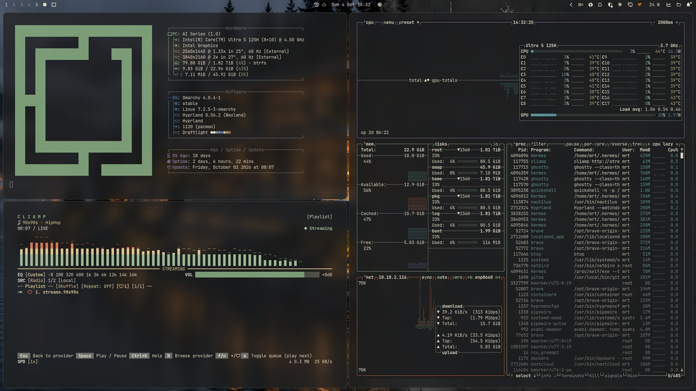

# Draftlight

A dark Omarchy theme: charcoal background, warm cream text, **sage green accent**, and vivid ANSI colors. Five 4K wallpapers (3840×2160) show modern architecture split between a dark photo-real render and a chalk-and-ink sketch on slate, each with its own color highlight.



## Installation

In the Omarchy menu choose `Install > Style > Theme` and enter this repo URL, or run:

```bash
omarchy theme install https://github.com/mrt187/omarchy-draftlight-theme
```

## Wallpapers

| File | Scene | Accent |
|---|---|---|
| `00-villa.jpg` | Lake villa in a pine forest | Amber |
| `01-tower.jpg` | Glass skyscraper at night | Blue |
| `02-museum.jpg` | Brutalist concrete museum | Red-orange |
| `03-bridge.jpg` | Modern bridge over a gorge | Green |
| `04-cliff.jpg` | Futuristic house on a sea cliff | Violet |

## Colors

| Name | Value |
|---|---|
| accent | `#8fa88a` |
| selection | `#2e3430` |
| selection foreground | `#ebe5d2` |
| muted | `#6f716c` |
| background | `#1c1d1e` |
| dark background | `#151617` |
| darker background | `#0f1011` |
| lighter background | `#2a2c2d` |
| foreground | `#e4ddc9` |
| dark foreground | `#b0aa9a` |
| light foreground | `#ebe5d2` |
| bright foreground | `#f4efe0` |
| red | `#e0502e` |
| yellow | `#e8bf4a` |
| orange | `#e8892f` |
| green | `#5fb86a` |
| cyan | `#2fb5b0` |
| blue | `#3a82d8` |
| magenta | `#a460d0` |
| brown | `#a8703c` |
| bright red | `#ff6a45` |
| bright yellow | `#ffd966` |
| bright green | `#7fd98a` |
| bright cyan | `#50d6d0` |
| bright blue | `#5c9eff` |
| bright magenta | `#c080f0` |

## License and AI disclosure

The wallpapers are **AI-generated** (OpenAI image generation) and upscaled to 4K with Real-ESRGAN. Theme and wallpapers are released under [CC BY 4.0](https://creativecommons.org/licenses/by/4.0/), see `LICENSE.md`.
